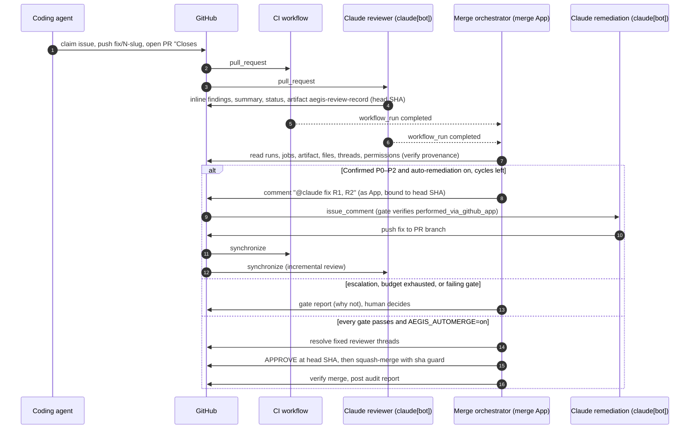

# Autonomous engineering pipeline: issue → PR → review → remediation → verified merge

This is the reference for the event-driven pipeline that lets coding agents implement
issues, has an independent reviewer judge every commit, sends verified findings back for
bounded remediation, and lets a **separate merge identity** approve and squash-merge
routine pull requests only after every gate is verified. Security-sensitive work is always
escalated to a human.

Related documents: [`CLAUDE_AUTOMATION.md`](CLAUDE_AUTOMATION.md) (reviewer and remediation
details), [`MERGE_APP_SETUP.md`](MERGE_APP_SETUP.md) (admin setup of the merge App and the
post-installation verification), [`ENGINEERING_WORKFLOW.md`](ENGINEERING_WORKFLOW.md)
(contributor guide), [`LUXURIO_COMPARISON.md`](LUXURIO_COMPARISON.md) (design lineage).

## 1. Lifecycle

```
 coding agent / human                       GitHub (events)                         identities
 ────────────────────                       ───────────────                         ──────────
 issue_claim ready / claim N  ──────────▶  issue: assignee + status:in-progress    author
 branch fix/N-slug, tests, push
 open PR "Closes #N"          ──────────▶  pull_request ─┬─▶ CI (ci-python, ci-frontend)      github-actions
                                                         └─▶ Claude PR review                  claude[bot]
                                                              ├ inline findings + summary
                                                              ├ advisory status claude-review
                                                              └ artifact aegis-review-record   (trusted record)
                                            workflow_run(completed) ─▶ AegisFlight merge orchestrator   merge App
                                              ├ review ERROR?  → re-run once (bounded)
                                              ├ P0–P2 Confirmed & AEGIS_AUTOREMEDIATE=on
                                              │      → "@claude fix R1, R2" (App comment)
                                              │            └▶ Claude remediation → push      claude[bot]
                                              │                  └▶ CI + fresh review (loop, ≤ N cycles)
                                              ├ escalation?    → report; human reviews and merges
                                              └ all 20 gates pass & AEGIS_AUTOMERGE=on
                                                     → resolve fixed reviewer threads
                                                     → APPROVE (commit_id = head)            merge App
                                                     → squash merge (sha = head)             merge App
                                                     → verify merged / 1 parent / on main
                                                     → audit report on the PR
 issue closes via "Closes #N" on merge (never earlier)
```



## 2. Components and identities

| Component | File | Identity that writes | Can it merge or approve? |
|---|---|---|---|
| Implementation agent | local Claude Code / Codex / human, following `AGENTS.md` §7 | the teammate's account (or an approved agent App listed in `policy.toml`) | No (AGENTS.md; ruleset requires a PR and an approval by someone other than the last pusher) |
| CI | `.github/workflows/ci.yml` | `github-actions` | No |
| Independent reviewer | `.github/workflows/claude-review.yml` + `.github/claude/review-policy.md` | `claude[bot]` (comments), workflow token (status, artifact) | No (`gh pr review/merge`, `gh api`, push denied) |
| Remediation agent | `.github/workflows/claude-remediate.yml` | `claude[bot]` (push to the PR branch only) | No |
| Merge orchestrator | `.github/workflows/aegis-orchestrator.yml` + `scripts/aegis_automation/` + `.github/automation/policy.toml` | **merge App** (`<slug>[bot]`) | Yes, and only here, only after the gate |
| Issue claiming | `scripts/aegis_automation/issue_claim.py` | the agent's account | No |

Separation of duties enforced in code (`merge_gate.py` G03/G20): the PR author can never be
the reviewer identity or the merge identity; the merge identity must not have authored or
committed any commit of the PR; the reviewer is never the approver. GitHub additionally
refuses self-approval, and the ruleset's *require approval of the most recent push* means
the approver cannot be whoever pushed last (the merge App never pushes).

Known limitation: the reviewer and the remediation agent share the `claude[bot]` identity
(the official Claude App). They are independent **sessions** (a fresh review runs on every
remediation push, with no memory of the fix), but not independent identities. Hardening
option: give the reviewer its own GitHub App via the action's `github_token` input.

## 3. Trust model: what the merge gate believes, and why

The gate never trusts text that an ordinary actor can write. In particular it ignores:
PR/issue/comment text claiming "READY", the `claude-review` commit status, check runs and
labels as proof of review. Any workflow token in this repository (including a workflow a
collaborator adds on a feature branch) can write a commit status or check run, so those are
**advisory only**.

| Fact | Accepted only from |
|---|---|
| "CI passed" | The workflow run GitHub records with `path == .github/workflows/ci.yml`, `event == pull_request`, `head_sha == PR head`, PR number associated, `conclusion == success`, and its jobs `ci-python`, `ci-frontend` = success; plus every check the default-branch ruleset requires (read live from `GET /rules/branches/main`); plus no other failing/pending check |
| "An independent review completed" | The artifact `aegis-review-record` of a run GitHub records with `path == .github/workflows/claude-review.yml`, `event == pull_request`, the PR's head SHA and PR number; the record must validate, name that run id, that head SHA, that PR and repository |
| Provenance not hijacked | No other PR (any state) uses the same head branch against a non-default base (a PR to another base would run that base's workflow files on the same SHA); the PR does not modify the review workflow |
| Who is who | `GET /collaborators/{login}/permission` at evaluation time; App identity from the token-minting action, compared with `AEGIS_MERGE_APP_SLUG` |
| Automatic remediation request | `performed_via_github_app.id == AEGIS_MERGE_APP_ID` on the comment, plus a marker naming the current head SHA |
| What changed | `GET /pulls/{n}/files` (paths, renames, added lines, sizes) |

Workflows matched by `workflow_run` are matched **by name**, so the orchestrator re-checks the
recorded **path** of the triggering run. Everything the orchestrator executes (code and
policy) comes from the default branch: `workflow_run`, `issue_comment` and
`workflow_dispatch` (guarded by `github.ref == default branch`) all run the default-branch
copy, and the job sparse-checks-out `main`. The review job extracts the record builder and
its JSON schema from the PR's **base** branch with `git archive`.

## 4. The review record (durable review state)

One JSON document per review run (`scripts/aegis_automation/review_record.py`), uploaded as
artifact `aegis-review-record` (90-day retention) and embedded in the merge audit comment
when a PR is merged (permanent). Schema `aegis.review-record/v1`:

| Field | Meaning |
|---|---|
| `repository`, `pr_number`, `head_sha`, `base_sha`, `base_ref` | What was reviewed |
| `reviewer.identity`, `reviewer.workflow`, `reviewer.run_id`, `reviewer.run_attempt` | Who/what produced it (bound to the run the gate verifies) |
| `model`, `mode` (`full`/`incremental`), `previous_reviewed_sha`, `deep` | How |
| `created_at` (UTC, `YYYY-MM-DDTHH:MM:SSZ`), `policy_sha256` | When, under which review policy |
| `outcome`, `verdict`, `valid`, `model_verdict`, `problems[]` | Result (below) |
| `counts{p0..p3}`, `findings[]{id,severity,confidence,path,line,title}` | Open findings with stable IDs `R<n>` |
| `previous_findings[]{id,status}` | `fixed` / `still_present` / `superseded` across commits |
| `acceptance_criteria[]{criterion,status}` | `met` / `not_met` / `cannot_verify` per issue criterion |
| `linked_issue`, `escalate`, `escalation_reason` | Issue binding and the reviewer's escalation |
| `ci_snapshot[]` | Check runs at review time (audit only; the gate re-reads CI) |

Verdicts are computed **deterministically** from the findings, never taken from the model:

| Verdict | Condition | Advisory status |
|---|---|---|
| `ERROR` | the review step failed / was cancelled / did not run | `error` |
| `INCOMPLETE` | no or malformed structured output, counts ≠ findings, duplicate IDs, the model said it could not finish, or a model verdict stricter than its own findings | `error` |
| `BLOCKING` | ≥ 1 P0/P1 | `failure` "P0:a P1:b P2:c P3:d (blocking findings; advisory)" |
| `NON_BLOCKING` | no P0/P1, ≥ 1 P2 | `success` "P0:0 P1:0 P2:c P3:d" |
| `READY` | no P0–P2 (P3 allowed) | `success` |

The status description format is unchanged from PR #36, so the remediation gate keeps working.

**Full vs incremental**: on `synchronize`, the newest earlier PR commit whose `claude-review`
status points to a verified run of `claude-review.yml` for that commit becomes the base of an
incremental review; otherwise (first review, label request, force-push that dropped the old
commit, forged status) the review is full. **Stale reviews**: every gate check binds to the
current head SHA; a new push makes the previous record irrelevant and a new review run
starts (the older one is cancelled by concurrency). **Duplicates**: `reopened` /
`ready_for_review` on a head that already has a record do not start a new model run; the gate
uses the newest completed run *that produced a record* for that same head SHA.

## 5. The merge gate (all must pass)

Implemented in `scripts/aegis_automation/merge_gate.py`; the report on each PR lists every
gate with ✅/❌ and the reason. Mapping to the required conditions:

| Gate | Condition |
|---|---|
| G01 | PR open, not draft, targets `main` |
| G02 | Head branch in this repository, not `main`, named `<type>/<issue>-<slug>` |
| G03 | Author has write (or higher) access, or is an approved agent identity; never the reviewer or merge identity |
| G04 | Exactly one linked open issue in this repo (GitHub closing reference), matching the branch number |
| G05 | The issue has acceptance criteria and the review assessed **all** as `met` (at least as many as the issue lists; `cannot_verify` fails) |
| G06, G07 | `ci-python`, `ci-frontend` succeeded in the verified CI run for the head |
| G08 | Every ruleset-required check is green; no other failing or pending check |
| G09 | A verified review run completed with a valid record and a `READY`/`NON_BLOCKING`/`BLOCKING` verdict (not `ERROR`/`INCOMPLETE`) |
| G10 | The record is bound to the exact head SHA, PR, repository and producing run |
| G11 | Provenance from GitHub run metadata (not comments/statuses); no shared-head-branch PR to another base; review workflow unmodified |
| G12 | No P0/P1 findings |
| G13 | Every P2 is fixed or waived by `/aegis waive R<n> <head-sha> <reason>` from a write-access human who is not the author, bound to this head |
| G14 | Remediation cycles ≤ limit; no remediation running or started after the review |
| G15 | No review or CI run in progress for the head |
| G16 | The head has not changed since the review (re-checked again immediately before approving) |
| G17 | No unresolved review thread, except the reviewer's own threads whose finding the record marks `fixed`/`superseded` (resolved automatically in mode `on`) |
| G18 | No escalation (§6) |
| G19 | Mergeable (no conflicts) |
| G20 | The merge identity is configured and separate from the author and every committer (blocking in mode `on`) |

Execution in mode `on` (`execute()`): resolve fixed reviewer threads → re-read the PR (abort if
the head moved) → reuse or submit `APPROVE` with `commit_id = head` → read the review back and
require `APPROVED` by the merge identity at the head → `PUT /merge` with `sha = head`,
`merge_method = squash`, an explicit title/message (`Closes #N`, no co-author trailers,
`[skip ci]` markers stripped) → verify `merged`, the merge commit has exactly one parent, and
it is on `main` → audit report (with the full review record). A refused approval or merge is
reported and **not retried**; GitHub's own ruleset remains the final arbiter.

## 6. Human escalation (never auto-merged)

A PR matching any category below is still reviewed (and gets recommendations), but the gate
reports it as escalated and a human approves and merges. Categories are deterministic
(`.github/automation/policy.toml`, `escalation.py`), evaluated on paths **and** rename
sources, plus added-line patterns, plus labels on the PR **or** its linked issue, plus the
reviewer's own `escalate` flag:

| Category | Triggers (abridged) |
|---|---|
| `automation_governance` | `.github/**` (workflows, reviewer policy, rulesets docs, CODEOWNERS, this policy), `scripts/aegis_automation/**`, `tests/automation/**`, `AGENTS.md`, `CLAUDE.md`, `.claude/**`, automation docs |
| `secrets_and_auth` | MAVLink signing, `*signing*`, `*secret*`, `*credential*`, key files; added private keys or tokens |
| `vehicle_link_safety` | serial/live sources, inline IPS, `mitigation/`, `proxy/`, `hal/`, SITL scripts; added `may_reach_vehicle`/MAVLink send calls |
| `frozen_contracts` | `core/`, `features/extractor.py`, `mavlink/codec.py`, `attacks/base.py`, `benchmark/`, `metrics/`, `docs/HANDOFF.md` |
| `event_log_integrity` | `logging/`, `integrity/` |
| `detector_metrics` | `detectors/`, `fusion/`, `features/`, `pipeline.py`, `config.py`, `configs/`, `models/`, training scripts |
| `evidence_claims` | `artifacts/**`, hardware scripts, evidence/validation docs, report drafts; `HITL`/`FIELD`/"real-world validation" in added Markdown |
| `network_listeners` | added `0.0.0.0`, `.bind(`, `.listen(`, `uvicorn.run(`, servers, `sudo` |
| `dependencies` | `pyproject.toml`, lockfiles, `frontend/package*.json` |
| `size` / `unverifiable` | > 40 files or > 1200 changed lines; binary or oversized diffs |
| `labels` | `needs:human-approval`, `needs:frozen-contract`, `needs:hardware`, `model:human`, `area:security`, `area:hardware`, `type:evidence`, `claude:escalation-recommended`, `automerge:hold` |
| `reviewer` | the review record has `escalate: true` |

Consequence: any PR that changes the pipeline itself (including the PR that introduced it)
can never merge itself.

## 7. Remediation

Two entry points, one gate (`claude-remediate.yml`):

1. **Human request**: a write-access human comments `@claude fix …` (unchanged from PR #36).
2. **Automatic** (off by default, `AEGIS_AUTOREMEDIATE=on`): after a verified review whose
   record has **Confirmed** P0–P2 findings, the orchestrator posts, as the merge App,
   `@claude fix the verified findings R1, R2 …` with the marker
   `<!-- aegis-auto-remediation sha=<head> findings=R1,R2 -->`. The remediation gate accepts a
   bot request only if GitHub records the comment as created by the App id
   `AEGIS_MERGE_APP_ID` (`performed_via_github_app`), the switch is on, and the marker names
   the current head.

Bounds and loop analysis:
- Never for: escalated PRs, drafts, forks, P3, Plausible-only findings, or when a remediation
  run is active. Per head SHA the App posts at most `max_auto_requests_per_head` (2)
  requests, and a second one only after a **newer** review of that head (so a remediation run
  that failed for infrastructure reasons does not stall the head; duplicate events for one
  review never re-post). Requests written by anyone else neither count nor block.
- The remediation job provisions bubblewrap and verifies a sandbox before Claude starts:
  Claude Code refuses to run with `CLAUDE_CODE_SUBPROCESS_ENV_SCRUB=1` without it (remediation
  run 44033857812). It fails closed instead of disabling isolation.
- Cycle limit `CLAUDE_MAX_REMEDIATION_CYCLES` (default 2), counted from markers that only the
  remediation workflow token posts; user-written markers do not count.
- Remediation verifies each finding before changing code (AGENTS.md §9), adds regression
  tests, runs `ruff` and `pytest`, pushes only to the PR branch, and cannot edit `.github/**`,
  `scripts/aegis_automation/**`, `tests/automation/**`, `AGENTS.md`, `CLAUDE.md`, `models/`,
  `artifacts/`; cannot merge, approve, force-push or call `gh api`.
- Its push triggers CI and a fresh, independent review; that review's completion triggers the
  orchestrator again. Each step is bounded: ≤ `max_cycles` remediations, ≤ 2 automatic
  requests per head SHA, ≤ `max_review_attempts` (2) runs per review.
- Recursion guards: the orchestrator ignores runs triggered by `push` (the post-merge CI on
  `main`), runs of workflows at other paths, bot comments (`issue_comment` requires a `User`),
  and its own approval/merge events (it does not listen to `pull_request_review`/`push`).
  `GITHUB_TOKEN` writes never trigger workflows.

## 8. Issue-driven work: the claiming protocol

`python -m aegis_automation.issue_claim` (run with `PYTHONPATH=scripts`):

| Command | Effect |
|---|---|
| `ready [--limit N]` | Lists claimable issues: open, `agent-ready`, unassigned, no `status:*`, not `needs:hardware`/`model:human`/`needs:human-approval`/`needs:frozen-contract`/`type:epic`/`type:tracking`/`automerge:hold`, every "Blocked by" issue closed, no open PR referencing it |
| `check N` | Explains why an issue is or is not claimable (exit 3 if not) |
| `claim N --branch fix/N-slug --agent ID` | Re-checks eligibility, posts a claim marker, re-reads the comments: the **earliest** active claim wins (creation time, then comment id). Winner: assign + `status:in-progress`. Loser: deletes its claim, exits non-zero |
| `status N in-review\|blocked\|in-progress` | Moves the issue's status label |
| `release N --agent ID --reason …` | Posts a release marker, removes status labels and the assignee |

Rules: one issue = one branch = one PR = one worktree; dependencies are respected ("Blocked
by" in the issue's table, a `### Blocked by` section, or an inline `Blocked by: #n`); the issue
is never closed by an agent: it closes when its PR merges via `Closes #N`, after the merge
gate (G05) or a human verified the acceptance criteria. Nothing launches agents
automatically, and nothing assigns the backlog in bulk.

## 9. Switches, modes and rollout

| Variable (repository) | Values | Default (unset) | Effect |
|---|---|---|---|
| `AEGIS_AUTOMERGE` | `off`, `dry-run`, `on` | `dry-run` | `off`: orchestrator job skipped. `dry-run`: evaluate and post one gate report per PR (edited in place); never approves or merges. `on`: approve + merge eligible PRs (requires the App) |
| `AEGIS_AUTOREMEDIATE` | `off`, `on` | `off` | Automatic `@claude fix` requests (requires the App) |
| `AEGIS_MERGE_APP_CLIENT_ID`, `AEGIS_MERGE_APP_SLUG`, `AEGIS_MERGE_APP_ID` | from the App settings page | unset | App identity; a slug mismatch aborts (no "unexpected identity" actions) |
| `CLAUDE_MAX_REMEDIATION_CYCLES` | integer | 2 | Shared by both remediation paths and the gate |
| Secret `AEGIS_MERGE_APP_PRIVATE_KEY` | PEM | – | **Environment `automerge` only** (deployment branches: `main`) |

Invalid values fail the run with an error; `on` without App credentials fails; nothing falls
back to the workflow token or to a less strict mode.

Recommended rollout: (1) merge this infrastructure (human review); (2) leave `dry-run` and
compare gate reports with human judgment on a few PRs; (3) install the App
([MERGE_APP_SETUP.md](MERGE_APP_SETUP.md)) and run its verification procedure; (4) set
`AEGIS_AUTOMERGE=on`; (5) optionally `AEGIS_AUTOREMEDIATE=on`.

**Emergency stop**: set `AEGIS_AUTOMERGE=off` (takes effect on the next event), or add
`automerge:hold` to a PR, or suspend the App installation. Admins keep the ruleset bypass.

## 10. Failure handling

| Failure | Behaviour |
|---|---|
| Review step fails / usage limit / infrastructure error | Record `ERROR`; orchestrator re-runs the review once (attempt 2 is final), then reports |
| Model output malformed or inconsistent | Record `INCOMPLETE`; never retried automatically (a human adds `claude:review` or `claude:deep-review`) |
| Review cancelled by a newer push | Ignored; the newer run decides |
| GitHub API transient error (5xx, 429, secondary rate limit) | Reads retried with backoff (3 attempts); writes are not blindly retried |
| Any exception or unreadable datum during evaluation | Gate closed (`error`), job fails visibly, nothing written except the report |
| Head moves during evaluation | Abort before approving; the push's own events re-evaluate |
| Approval refused or not recorded | Stop; no merge call; report |
| Merge refused (ruleset, conflict, SHA mismatch) | Report the GitHub message; not retried; the approval at that SHA is dismissed by GitHub on the next push |
| Merge result not a single-parent commit on `main` | Reported as `merge_failed` for a human to inspect |
| Concurrent events for one PR | Serialised by `concurrency` (no cancellation); later runs see the merged/closed PR and stop |

## 11. Security summary

| Threat | Control |
|---|---|
| Fork PR with malicious code | `pull_request` only (no secrets); review job skipped for forks; orchestrator ignores non-same-repo runs; remediation refuses forks; no `pull_request_target` anywhere |
| PR weakens its own reviewer/merge policy | Review policy, record builder, schema and merge policy are loaded from the base/default branch; any `.github/**` or automation change is escalated; the merge gate itself runs only default-branch code |
| Forged "review passed" (status, check run, label, comment) | Ignored; only the verified run's artifact counts (§3) |
| Feature-branch workflow steals the merge App key | Key stored in environment `automerge` whose deployment-branch policy is `main` only; the orchestrator job also checks `github.ref` |
| Prompt injection in PR content | Reviewer policy treats PR text as data (P1 finding); decisions use deterministic counts; escalation is computed from paths/content, not the model; model text rendered in reports is neutralised (`safe_text`) |
| Old review authorises a new commit | Every gate binds to the head SHA; approval uses `commit_id`, merge uses `sha` |
| Runaway loops / cost | Bounded retries, cycles and per-SHA requests; no polling; concurrency per PR |
| Self-approval / single identity doing everything | Distinct implementation, reviewer and merge identities, checked in code (G03, G20) and by GitHub |
| Supply chain | Every action pinned to a full SHA (`actions/checkout` v7.0.1, `setup-python`/`setup-node` v7.1.0, `upload-artifact` v7.0.2, `create-github-app-token` v3.3.0, `claude-code-action` v1.0.277); the orchestrator uses only the Python standard library |

Token permissions: orchestrator job `contents/actions/checks/statuses: read`,
`pull-requests/issues: write` (report only); App token narrowed per run to `contents: write,
pull_requests: write, issues: write, actions: write, checks: read, statuses: read`.

## 12. Cost and usage

- The orchestrator never calls a model. It costs a few seconds of GitHub-hosted runner time
  per CI/review completion (free on this public repository).
- Model usage remains: one Sonnet review per ready, non-draft push (incremental where
  possible, deduplicated on `reopened`/`ready_for_review`), Opus only on `claude:deep-review`,
  and at most `CLAUDE_MAX_REMEDIATION_CYCLES` remediation sessions (60 turns each) per PR,
  plus at most one automatic review re-run per ERROR.
- Worst case per PR with automatic remediation on and the default limits: 1 + 2 reviews from
  remediation pushes + author pushes, 2 remediation sessions, ≤ 1 retry per failed review.
- All runs bill the Claude subscription behind `CLAUDE_CODE_OAUTH_TOKEN` (see
  `CLAUDE_AUTOMATION.md` §7); usage limits surface as `ERROR` records, which are retried once
  and then reported, never treated as `READY`.
- Cost levers: keep PRs in draft while iterating, batch pushes, `claude:skip-review` for
  trivial PRs (such PRs then cannot auto-merge, because they have no record), lower
  `CLAUDE_REVIEW_MAX_TURNS`, keep `AEGIS_AUTOREMEDIATE=off`.

## 13. Commands

| Comment (write-access human) | Effect |
|---|---|
| `/aegis merge-check` | Re-evaluate the gate now (e.g. after resolving a thread or removing `automerge:hold`) |
| `/aegis waive R3 <head-sha-prefix ≥ 7> <reason>` | Waive P2 finding R3 for this exact head (not the PR author; P0/P1 cannot be waived) |
| `@claude fix …` | Request remediation (see `CLAUDE_AUTOMATION.md` §4) |

## 14. Validation status

"Mocked" means proven against an in-memory GitHub API (`tests/automation/`); "live" means
observed on GitHub. A mocked pass is **not** evidence of live GitHub behaviour.

| Area | Evidence |
|---|---|
| Gate conditions G01–G20, provenance/forgery cases, stale SHA, CI failure, missing issue / criteria, P0–P3 policy, waivers, escalation, duplicate events, running reviews, remediation limits, self-approval/identity separation, approval and merge failures, squash verification | Mocked: `tests/automation/test_automation_merge_gate.py` |
| Record verdicts (ERROR/INCOMPLETE/BLOCKING/NON_BLOCKING/READY), tamper detection, injection neutralisation, CLI | Mocked/unit: `test_automation_review_record.py` |
| Event routing, recursion prevention, bounded retry, auto-remediation bounds, end-to-end orchestration | Mocked: `test_automation_orchestrator.py` |
| Claiming protocol and race resolution | Mocked: `test_automation_issue_claim.py` |
| Workflow pinning, permissions, trigger safety, cross-file contracts | Static: `test_automation_workflows.py`; `actionlint` 1.7.12 + `shellcheck` 0.11.0 |
| `automerge` environment (branch policy `main`) and labels `automerge:hold`, `status:*` | Live: created on 2026-11-17 |
| API assumptions of the gate: run `path`/`event`/`pull_requests` fields, `actions/runs?head_sha=`, job names, `rules/branches/main` shape, `performed_via_github_app` on App comments | Live (2026-11-17), against PR #38's runs and #37's `claude[bot]` comment |
| Merge App: token minted only inside `automerge`; installation scoped to this repository; gate run in mode `on` refuses a non-eligible PR; App comment has `performed_via_github_app = 5795459`; **App approval turns `reviewDecision` REVIEW_REQUIRED → APPROVED**; merge with a wrong SHA refused (409); `merge_gate.execute()` squash-merged PR #41 as `e0c51f0` (merged by `app/aegisflight-merge-bot`, one parent, tip of `main`, no co-author trailer); App re-run of a workflow run accepted | **Live** (2026-11-17), temporary harness on branch `test/merge-app-live`, run 44027198952 attempts 1–2 |
| Ruleset required checks | Live finding: they were pinned to source app 1236702 (Claude) while CI reports as GitHub Actions (15368), so no PR could pass (first merge attempt: 405 "not set by the expected GitHub apps"). Source corrected to 15368 on 2026-11-17; all other ruleset fields unchanged |
| Real open PRs through the real gate (read-only, mode `on` semantics) | Live: #38 and #39 escalated (automation, signing, vehicle link, frozen contracts, detectors, evidence, dependencies, size); #40 (routine) fails only the review-record gates G05/G09–G13/G16 |
| Orchestrator workflow on `main`, review record artifact from the new reviewer, automatic remediation round trip, `resolveReviewThread` with the App token | **Not verified live**: needs PR #38 on `main` (post-merge steps in `MERGE_APP_SETUP.md` §6) |
